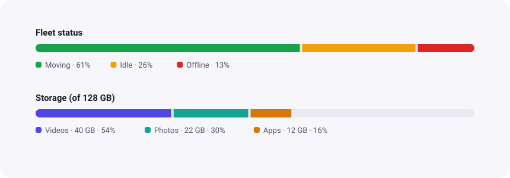

# segmented_bar_lite

[](https://pub.dev/packages/segmented_bar_lite)
[](https://github.com/senkop/segmented_bar_lite/actions/workflows/ci.yml)
[](LICENSE)

A horizontal bar that shows parts of a whole: fleet status, storage, budgets, votes. No dependencies.

- Colored segments with gaps and rounded ends
- Grow animation
- Legend with labels, values and percentages
- `total` for "used of capacity" bars with empty track
- Screen-reader summary



## Install

```bash
flutter pub add segmented_bar_lite
```

## Usage

```dart
import 'package:segmented_bar_lite/segmented_bar_lite.dart';

SegmentedBar(segments: const [
  BarSegment(value: 42, color: Colors.green, label: 'Moving'),
  BarSegment(value: 18, color: Colors.orange, label: 'Idle'),
  BarSegment(value: 9, color: Colors.red, label: 'Offline'),
])

SegmentedBar(
  total: 128,
  valueFormatter: (v) => '${v.toStringAsFixed(0)} GB',
  segments: storage,
)
```

## Example

```bash
cd example
flutter create .
flutter run -d chrome
```

## License

MIT
